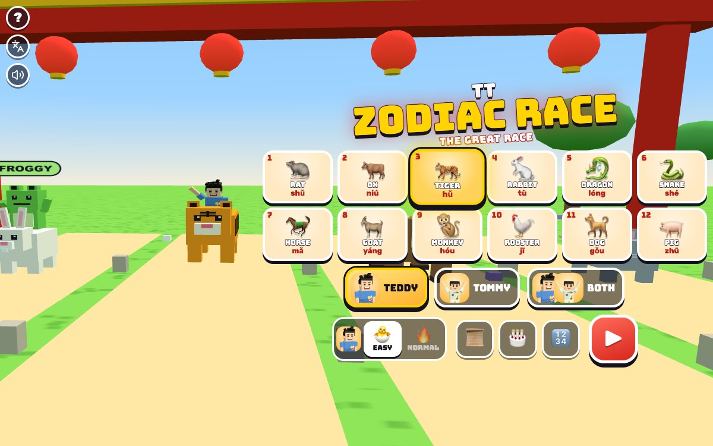

# TT Zodiac Race

[](https://adong.github.io/zodiac-race-tt/)

Press **?** any time (or tap the round **?** button in the top left corner) to see the keys. The game waits while you look.
Tap the language button under it (the A文 icon) to switch between English and 中文; the dashboard and every game remember the choice.

**中文：** 十二生肖大赛跑：选一个生肖，骑着它游过大河，跑到玉皇大帝的宫殿！老鼠骑牛，龙会飞，老虎游得快；还能查一查全家人属什么，排一排十二生肖的顺序。

The Great Race of the Chinese zodiac (十二生肖), starring Teddy and Tommy. Long ago the Jade Emperor held a race across a great river, and the first twelve animals to reach his palace each got a year. Pick one of the twelve, climb on its back and race the other eleven across the meadow, the river and the bamboo path. Every animal has its own power from the story: the Rat hops onto the Ox's back and leaps off ahead, the Tiger swims strong, the Dragon flies, the Snake hides on the Horse's hoof, the Goat floats on a raft. Foxy 🦊 and Froggy 🐸 ride along on two of the others. There's a six-page story card, a birth-year finder ("what animal am I?") for the whole family, and a line-up game to learn the order.

It's built with Claude Code from plain JavaScript and Three.js, in the same style as Metro Surfer and the other Teddy & Tommy games. It's part of the 中国 series (helping the boys feel their culture). There are no image, model or audio files: the animals, the river and the palace are boxes and canvas textures, Teddy and Tommy come from the shared kit (`kit/`), and every sound is synthesised.

The name lives in one place, [js/title.js](js/title.js). "TT Zodiac Race" is a working title until Alan names it.

## Play

- **Double-click `index.html`.** It works offline, because Three.js and the kit are copied into `kit/`. Without internet the logo falls back from the Bungee font to Arial Black.
- **Send one file:** `dist/zodiac-race-tt.html` is the whole game in one file. AirDrop or email it, then open it in a browser.
- **Rebuild that file** after any edit: `python3 kit/tools/bundle.py . --name zodiac-race-tt`
- **Get kit updates** from `~/claude-games/kit`: `python3 ../kit/tools/sync.py .`, then rebuild.
- **On the home screen** pick your animal (the twelve cards are in zodiac order, numbered 1 to 12, with the pinyin under each name, or the character in 中文), who races (TEDDY, TOMMY or BOTH), 🐣 EASY or 🔥 NORMAL for each brother, then ▶. 📜 is the story, 🎂 the birth-year finder, 🔢 the line-up game.
- **Each race** starts with a count-in (3, 2, 1, GO! and a gong) and lasts about 45 to 70 seconds.
- **The end:** the animals run through the finish gate into the palace courtyard, the brothers (and the winner) walk up next to the Jade Emperor (玉皇大帝) on his throne, and the winning brother stands up on his animal for his signature move (Teddy's boxing combo, then his 🏀 jump shot; Tommy's Y with peace fingers ✌️) while confetti and firecrackers go off. Then the results: this race's order of all twelve, next to the story's order, a fact about your animal ("In the story the Tiger came 3rd. Today it came 1st!"), your time, best time and 🏆 wins. 🔁 races again, 🏠 goes home.
- **Saved per browser:** who races, each brother's animal and level, the best time for every animal at each level, each brother's 🏆 wins (on his button), the family list in the finder and the line-up best times. `index.html` and `dist/zodiac-race-tt.html` each keep their own, because they're different ways of opening the game.

### The race

- **All twelve animals race at once,** each in its own lane, in zodiac order from the Rat on the left to the Pig on the right. Every lane has the same rocks, logs, whirlpools and peaches (every other lane mirrored), so it's a fair race.
- **The course:** the meadow (45 m), the great river (calm water, the lotus pond, fast water and big waves: 320 m) and the bamboo path (75 m) to the palace gate, 440 m in all.
- **Your animal runs by itself.** ◀ ▶ move it between three spots in its lane; ⤴ hops.
- **Rocks** stop you with a BONK (move round them). **Logs** float across the whole lane (hop over them). **Whirlpools** spin you round (move or hop). **Peaches** 🍑 give a burst of speed and charge your power.
- **Every animal is as fast over the whole course:** some run faster and swim slower (Horse, Rabbit, Rat), some swim better (Ox, Tiger, Dog, Snake), and the numbers are scaled so the totals match.

### The powers

The power button (your animal's face) fills up as you go and glows when it's ready. Tap it (or Enter) to use it.

| | Animal | Power | What it does |
|---|---|---|---|
| 1 | 🐀 Rat | RIDE | hops onto the Ox's back if he's close, rides along for 5 s, then leaps off ahead. Too far away: scurries fast instead |
| 2 | 🐂 Ox | STRONG | pushes straight through rocks and logs for 5 s, a bit faster |
| 3 | 🐅 Tiger | SWIM | a strong burst, strongest in the water |
| 4 | 🐇 Rabbit | HOP | big bunny hops over everything for 4 s |
| 5 | 🐉 Dragon | FLY | flies over everything for 4 s |
| 6 | 🐍 Snake | RIDE | hides on the Horse's hoof, then jumps off ahead: SURPRISE! (or slithers fast) |
| 7 | 🐎 Horse | GALLOP | a burst, strongest on land |
| 8 | 🐐 Goat | RAFT | floats on a bamboo raft for 5 s, safe from everything |
| 9 | 🐒 Monkey | SWING | swings over everything for 4 s |
| 10 | 🐓 Rooster | FLAP | flaps over everything for 4 s |
| 11 | 🐕 Dog | PADDLE | doggy paddle, strongest in the water |
| 12 | 🐖 Pig | SNACK | a snack, then 5 s of snack power |

The CPU animals use their powers too, so the Rat may ride your Ox ("THE RAT HOPPED ON YOUR OX!") and jump off.

### EASY and NORMAL

| | 🐣 EASY (Tommy, 5) | 🔥 NORMAL (Teddy, 8) |
|---|---|---|
| steering | your animal slips round rocks and whirlpools by itself (◀ ▶ still work) | you steer |
| logs | none | 5, hop over them |
| rocks / whirlpools | 7 / 3 | 14 / 6 |
| power charges in | 7 s | 9 s |
| the other animals | slower, wait for you when they're ahead, and on the bamboo path they're always a bit slower than you | a real race |

With BOTH racing, the other animals race at the EASY level if either brother is on EASY.

### What animal am I?

The 🎂 button (or **Y**) opens the birth-year finder. Pick a year with −10 −1 +1 +10 (or type four digits, or ← → and ↑ ↓) and it shows that year's animal, its number in the zodiac and the other years of the same animal.

- **The Chinese New Year catch:** a zodiac year starts at Chinese New Year (between January 21 and February 20), not on January 1. The finder says the date for that year ("In 2018 that was February 16") and has a **BORN BEFORE FEBRUARY 16?** box: tick it and it shows the year before's animal (born February 10, 2018: a Rooster, not a Dog).
- **The dates** for 1924-2043 are in a table in [js/zodiac.js](js/zodiac.js), and the checks prove every one of them is a new moon in Beijing. Outside those years the finder says "between late January and mid February".
- **The family:** tap a face (👦 🧒 👨 👩 👴 👵) to save the year for that person; the chips stay in the browser, and a tap on one shows it again.

### Line them up!

The 🔢 button (or **O**) shuffles the twelve animals; tap them in zodiac order, 1 to 12. A wrong tap shakes and says its real number. If the first brother is on EASY, the right one wiggles after 4 seconds (or after a wrong tap); on NORMAL after 9. Finishing gets confetti, the time and NEW BEST!

### The story

The 📜 button (or **B**) opens a six-page story card in simple words: the Jade Emperor's race, the Rat riding the Ox and jumping off to come first, the Tiger swimming, the Rabbit on stones and a log, the Dragon stopping to make rain and help the Rabbit, the Snake on the Horse's hoof, the Goat, Monkey and Rooster crossing together on a raft, the Dog playing in the water and the Pig stopping for a snack and a nap. It reads in English, or in 中文 after a tap on the language button.

## Controls

| Teddy (left, or anyone alone) | Tommy (right, or anyone alone) | Touch | |
|---|---|---|---|
| `A` `D` | `←` `→` | ◀ ▶ | move left / right |
| `W` or `Space` | `↑` or `Enter` | ⤴ | hop |
| `S` | `↓` | your animal's button | the power |
| `T` | `T` | your brother's face (1 player) or ✋ (2 players) | call your brother · high five |
| `P` / `Esc` | | ⏸️ button | pause (▶ keep racing, 🔁 start again, 🏠 home) |
| `M` | | 🔊 button | sound on / off |

- **1 player:** both sets of keys work; Space hops and Enter uses the power.
- **2 players:** the screen splits in two, Teddy on the left and Tommy on the right (on a tall screen, Teddy on top). Each half has its own ◀ ▶ ⤴ and power button.
- **On the home screen:** `←` `→` (or `A` `D`) pick the animal (with both racing, `A` `D` is Teddy's and `←` `→` Tommy's; with the mouse, cards are picked turn about, Teddy first), `↑` `↓` the level (`W` `S` for Teddy), `1` `2` `3` who races, `B` the story, `Y` the finder, `O` the line-up game, `Enter` or `Space` to race. On the results, `Enter` races again, `Esc` goes home.
- **Sizes:** the steering and hop buttons are at least 64 px and the power button 76 px, at the bottom corners on a phone held either way; the kit's buttons (?, A文 and the speaker on menus) are a column in the top left corner, away from the play buttons.

## Companion

Call your brother any time in a race, as often as you like: **T**, or tap his face (the round button above the power button). The brother comes from `Kit.roster.buddyFor`: Tommy when Teddy races, Teddy when Tommy races.

- **He flies in on a golden lucky cloud** (祥云) next to you, at his buddy size (`buddyScale`), and says hello with his signature move: Teddy's boxing combo and his 🏀 jump shot, Tommy's Y with peace fingers.
- **He tosses a treat** (🍦 💧 🧃 🍪 🍉 🍌) to you: "🍪 COOKIE FROM TOMMY!".
- **Then he gives you a ride across the next stretch:** "TOMMY SAYS: HOP ON! I'LL GIVE YOU A RIDE!". Your animal hops onto the cloud and flies over the rocks and logs, faster than any animal, to the end of the next stretch of the course (at least 40 m on). Then "THANK YOU FOR THE RIDE!" and he floats off waving.
- **Calling again while he's there** says hello again, brings another treat and takes you one more stretch.
- **With two players** both brothers are already racing, so **T** (or ✋) is a high five: both wave, sparkles fly, and both get the same little boost for 3 seconds.

## How it was checked

Nobody listened (Alan works next to the sessions), so the game was tested muted and the sound was checked in code.

**Headless, in Node:** `node tools/check.js` runs the brief's checks with the page's own code ([js/zodiac.js](js/zodiac.js), [js/race.js](js/race.js), [js/checks.js](js/checks.js)) in about 9 seconds. In the page the same checks run as `game.check()`. All pass:

- **finder (the year-to-animal finder is right):** 24 years everyone knows (1984 Rat, 2000 Dragon, 2018 Dog, 2020 Rat, 2026 Horse...), every year 1900-2100 follows the one before and matches the one twelve years on, and the Chinese New Year caveat for every year 1924-2043 (born the day before New Year: the year before's animal; on the day: the new one; January 1 and March 1 too): 480 birthdays. Every New Year date in the table is the day of a new moon in Beijing, worked out with the Meeus new-moon formula.
- **everyFinishes (every animal can finish):** each of the twelve, played by a pretend player doing nothing, a wobbly 5-year-old, one bashing every button and a perfect one, on both levels, crosses the line (96 races); and in races run until everyone is home, all twelve CPU animals cross it.
- **racesEnd (races end):** 72 races with every pretend player, both levels, 1 and 2 players: every race ends with all twelve animals placed 1 to 12 and both brothers over the line, never by the safety cap (240 s); the longest is 74 s.
- **fair:** every animal alone with perfect play is within 6 % of the others (3.6 % now); on EASY a wobbly 5-year-old autopilot wins 95 of 96 races (at least 7 of 8 with every animal); on NORMAL perfect play wins 58 of 60, a good 8-year-old 32 of 60 (30-85 % allowed) and doing nothing never.
- **The checks can fail:** each one is also run broken on purpose and must then fail: the animals counted from the wrong year, the New Year caveat forgotten, 2034's New Year a day early, a pig that can't swim, animals that don't run by themselves, a horse 30 % faster, and EASY without its catching-up.

**In the page** (headless Chrome over the DevTools protocol, `tools/shoot.js`, time driven by `game.step()`):

```js
localStorage.setItem('claudeGames.muted', '1')   // always, before anything plays
game.hold(true)                                  // only game.step() moves time
game.start({ who: 'both', animals: { teddy: 'ox', tommy: 'rat' }, levels: { teddy: 'normal', tommy: 'easy' }, seed: 7 })
game.autopilot('kid')                            // or 'perfect', 'teddy', 'idle', 'mash', 'buddy', or null
game.step(10)                                    // advance 10 s at 60 fps, drawing as it goes; game.step(60, true) draws only the end
game.steer(0, -1); game.jump(0); game.power(0); game.buddy(0); game.five(); game.pause(true)
game.finder(true, 2018, true)                    // 'rooster': born before New Year 2018
game.check()                                     // the headless checks, with their proofs
game.info()                                      // state, race time, the brothers, the finish order
```

- **Flows:** races to the results with wins and losses, 1 and 2 players, both levels; the cloud ride (treat, toast, ride to the stretch end, a second call); the Rat riding the Ox and leaping off; every power's toast; keys (home: animal, level, who, B, Y, O, typing a year; race: Space, Enter, A D, ← →, W S ↑ ↓ in 2 players, T, P, M; results: Enter, Esc) and pointer taps on ◀ ▶ ⤴, the power button, the face button and the cards.
- **Screens:** desktop (800 x 600, 1200 x 750), iPad landscape (1024 x 768) and portrait (820 x 1180, 2 players top and bottom), phone portrait (390 x 844) and landscape (740 x 360).
- **中文:** with `Kit.lang.set('zh')`, the home screen (1 player and BOTH), all six story pages, the finder (a year in the table and one outside it, with and without the box ticked), the line-up game (start, a wrong tap, done), the ? panel, the count-in, racing with powers, the cloud ride, pause, a win, a loss and 2-player results: `Kit.lang.untranslated()` is `[]` everywhere. What's left in English is names (the game, Teddy, Tommy, Foxy, Froggy). In English mode nothing on the page is Chinese except the kit's language button tooltip, which names the language a tap switches to; the zodiac signs show as pinyin (shǔ, niú, hǔ...).
- **The single file** (`dist/zodiac-race-tt.html`) opened from `file://` in headless Chrome: a whole race to the results and `game.check()` passing, no page errors. No console errors anywhere.

## Files

```
index.html          page, menus, HUD, play buttons, overlays (CSS inline)
js/title.js         the game's name, in one place
js/zodiac.js        the twelve animals, the birth-year finder, the Chinese New Year dates and the new-moon formula (runs in Node)
js/race.js          the race: the course, speeds, steering, hops, rocks, logs, whirlpools, peaches, the powers, the rides,
                    the cloud ride, the CPU animals, EASY's help, the finish order, the pretend players (runs in Node)
js/checks.js        the headless checks and their proofs (game.check() and tools/check.js)
js/sfx.js           the gong, splashes, bonks, powers, firecrackers and a little pentatonic tune, through Kit.sound
js/animals.js       the twelve blocky animals, Foxy and Froggy, the Jade Emperor on his throne, the cloud, the raft
js/world.js         Three.js: the meadow, the river and its lanes, the bamboo path, the gates, the palace, the scenery
js/game.js          home, the story, the finder, the line-up game, the race loop, input, cameras, split screen,
                    the companion, results, window.game
js/keys.js          the keys the ? panel shows (Kit.help)
js/zh.js            中文 (Kit.lang); names and the game's name stay English
tools/check.js      the headless checks in Node
tools/shoot.js      screenshots and page tests in headless Chrome (docs/screenshot.jpg: node tools/shoot.js tools/shots.json docs 1200 750)
kit/                copy of ~/claude-games/kit; edit the kit there, not here
dist/zodiac-race-tt.html  the single-file build
```

## Not verified

- **The sound:** nobody has listened to the gong, the splashes, the powers, the firecrackers or the tune.
- **Real touch devices:** the buttons use pointer events, tested with scripted events and at phone and iPad sizes, not with fingers on a real iPad or phone or in iOS Safari (two players tapping at once is untested).
- **Frame rate on an iPad:** not timed on a device. Twelve animals and their riders are on screen, and two players draw the scene twice.
- **How hard it is for real kids:** EASY and NORMAL were tuned with pretend players, not by watching Teddy and Tommy race.
- **The story's details:** it follows the best-known telling (the Rat on the Ox, the Dragon stopping to make rain, the Snake on the Horse's hoof, the Goat, Monkey and Rooster on a raft); other tellings differ a little, and some include the Cat, left out here.
